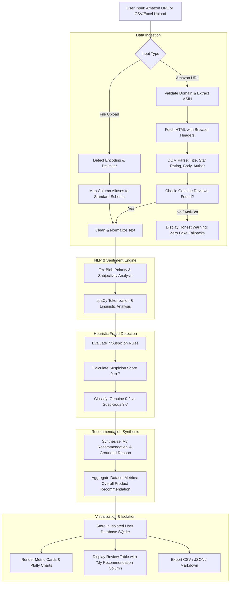

# 🛡️ Amazon Review Insight Pro Analyzer

> **An intelligent NLP-powered consumer intelligence platform designed to scrape authentic Amazon reviews, detect review manipulation through 7 heuristic suspicion indicators, synthesize grounded product purchase recommendations, and isolate user workspaces securely.**

---

## 📌 1. Project Overview

E-commerce marketplaces like Amazon host hundreds of millions of consumer reviews. However, consumers and businesses face two critical challenges:
1. **Review Fraud & Manipulation**: Up to 30% of online reviews are estimated to be incentivized, bot-generated, or fake.
2. **Information Overload**: Reading hundreds of reviews to make an informed purchasing decision is overwhelming and time-consuming.

**Amazon Review Insight Pro** solves these challenges by combining Natural Language Processing (NLP), rule-based heuristic anomaly detection, and a grounded recommendation engine into an interactive, high-contrast dashboard.

### 🎯 Key Value Propositions
- **Authenticity-First Scraping**: Accepts any valid Amazon product URL across all global marketplaces (`.com`, `.in`, `.co.uk`, `.de`, `.ca`, etc.) and retrieves **only actual reviews**. It strictly forbids the injection of fake, mock, or simulated reviews.
- **My Recommendation Engine**: Replaces generic raw sentiment labels with actionable buying recommendations (`Recommended`, `Not Recommended`, `Mixed`) accompanied by genuine review-backed reasoning without hallucination.
- **7-Factor Heuristic Fraud Detection**: Flags suspicious reviews based on concrete linguistic traits (extreme brevity, word repetition, excessive capitalization, promotional phrases, hyperboles, and corpus duplication).
- **Secure Multi-User Privacy**: Features isolated SQLite databases with PBKDF2-HMAC-SHA256 password security, interactive eye-toggle visibility, and session-level isolation.
- **Universal Data Ingestion**: Seamlessly parses CSV and Excel files with automatic encoding detection, delimiter sniffing, and prominent file metadata display.

---

## 🛠️ 2. Technology Stack & Architectural Decisions

| Layer | Technology | Version | Purpose & Architectural Decision |
|---|---|---|---|
| **Frontend UI** | Streamlit | `>= 1.28.0` | Reactive Python web framework enabling rapid prototyping, real-time widget reactivity, and clean component isolation. |
| **Typography & Theme** | Google Fonts (Poppins), CSS3 | Custom | Custom-injected high-contrast dark theme (`#0F172A`, `#1E293B`, `#F8FAFC`) with full accessibility compliance. |
| **Backend Language** | Python | `3.10+` | Clean, readable, and standard ecosystem for data science and web development. |
| **Database** | SQLite 3 | WAL Mode | Embedded relational database with Foreign Key constraints and Write-Ahead Logging for atomic user isolation. |
| **Security & Auth** | `hashlib` (PBKDF2-HMAC-SHA256) | Standard Lib | NIST-compliant password hashing with 100,000 iterations and unique 32-byte cryptographic salts. |
| **Data Processing** | Pandas & OpenPyXL | `>= 2.0.0` | High-performance tabular data manipulation, encoding auto-detection, and flexible column alias mapping. |
| **Sentiment Analysis** | TextBlob | `>= 0.17.1` | Rule-based lexicon sentiment scoring computing polarity (`-1.0` to `+1.0`) and subjectivity (`0.0` to `1.0`). |
| **NLP Tokenization** | spaCy (`en_core_web_sm`) | `>= 3.7.0` | Linguistic dependency parsing, part-of-speech tagging, and key phrase extraction with graceful pure-Python fallback. |
| **Data Visualizations** | Plotly Express & Graph Objects | `>= 5.17.0` | Interactive SVG/WebGL charts (donut breakdown, rating bars, suspicion distribution) with custom dark palettes. |
| **Web Scraping** | Requests & BeautifulSoup4 | `>= 4.12.0` | HTTP client with realistic browser headers and DOM traversal for live Amazon product review extraction. |

---

## ✨ 3. Core Features & Recent Enhancements

### 1. Universal Amazon Product URL Scraper (Strictly Real Reviews Only)
- Accepts **any valid Amazon URL** from all global marketplace domains (`amazon.com`, `amazon.in`, `amazon.co.uk`, `amazon.de`, `amazon.ca`, `amazon.co.jp`, etc.).
- Robustly extracts standard 10-character alphanumeric ASINs from paths (`/dp/ASIN`, `/gp/product/ASIN`), query parameters (`?asin=ASIN`), and shortened links (`amzn.to`, `a.co`).
- **No Mock or Fake Reviews**: Extracts only actual customer reviews directly from Amazon DOM nodes (`reviewRichContentContainer`, `review-text-content`, `review-body`). If Amazon blocks requests due to anti-bot CAPTCHAs, it honestly alerts the user rather than fabricating synthetic data.

### 2. Interactive Password Eye Icon Toggles
- All password fields across the application (Login, Registration, Password Confirmation, and Password Reset) feature interactive eye icon toggle buttons (`👁️` to view, `🙈` to hide).
- Replaced non-standard static visibility text with standard responsive toggling without conflicting with form submissions.

### 3. Resilient File Upload & High-Contrast Filename Card
- Supports CSV (`.csv`) and Excel (`.xlsx`, `.xls`) uploads.
- Auto-detects text encodings (`utf-8`, `utf-8-sig`, `latin-1`, `cp1252`, `iso-8859-1`) and sniff delimiters (`,`, `;`, `\t`, `|`).
- Automatically maps messy column headers (`review_text`, `comment`, `Feedback`, `stars`, `score`, `rating`).
- Displays a dedicated high-contrast file metadata card displaying:
  - 📄 Uploaded file name
  - 💾 File size formatted in KB or MB
  - 🏷️ File format extension badge
  - 📊 Row count and column count parsed

### 4. Crystal-Clear "About" Knowledge Section
- Fully redesigned with high-contrast `#F8FAFC` headings, vibrant accent borders, and `#E2E8F0` body text.
- Provides comprehensive transparency regarding the platform's mission, complete technology stack, exact mathematical thresholds for all 7 heuristic rules, recommendation engine criteria, security safeguards, and known limitations.

### 5. "My Recommendation" Column (Replacing Sentiment)
- In the Review Data inspection table, the raw, generic `Sentiment` column has been replaced with **`My Recommendation`**.
- Evaluates individual customer experiences into clear, actionable classifications:
  - **Recommended** (Green badge): Positive experience (4-5 stars or positive sentiment) highlighting specific satisfied customer feedback.
  - **Not Recommended** (Red badge): Unfavorable experience (1-2 stars or negative sentiment) citing customer complaints (e.g., poor quality, failure, return).
  - **Mixed** (Amber badge): Balanced feedback (3 stars or conflicting praise and criticism).
- Accompanied by a concise, factual explanation derived strictly from the actual review text—**no hallucinated or invented facts**.
- Includes an executive-level **Overall Product Recommendation Summary** card synthesizing dataset-wide metrics.

---

## 🔄 4. End-to-End Working Process & Pipeline



---

## 🔍 5. The 7-Factor Heuristic Suspicion Framework

To identify potentially manipulated or fake reviews without requiring costly black-box machine learning APIs, the platform implements 7 explainable linguistic heuristics:

1. **Short Review Check**: Reviews with fewer than 5 words provide zero substantive product detail and often inflate rating counts (`word_count < 5`).
2. **Word Repetition Check**: Bot-generated or spam reviews frequently repeat keywords. Flagged if any single word accounts for $> 30\%$ of total tokens.
3. **Excessive Capitalization**: Spam reviews frequently abuse ALL-CAPS to attract attention (`uppercase_ratio > 0.50`).
4. **Excessive Exclamation**: Aggressive promotional hype identified by 3 or more exclamation marks (`! count >= 3`).
5. **Promotional Keywords**: Presence of sponsored or promotional markers (e.g., *"free sample"*, *"sponsored"*, *"promo code"*, *"discount code"*, *"full refund"*).
6. **Hyperbolic Language**: Reviews relying purely on extreme ungrounded superlatives (e.g., *"life changing"*, *"miracle product"*, *"greatest ever"*) with high subjectivity and zero constructive criticism.
7. **Corpus Duplicate Check**: Detects copy-pasted bot reviews by comparing the review against the rest of the dataset using sequence matching (`similarity_ratio >= 0.85`).

**Final Authenticity Scoring**:
- **0 to 2 triggers**: `Genuine-looking` (Standard consumer variability).
- **3 or more triggers**: `Suspicious` (High probability of astroturfing or manipulation).

---

## 💡 6. The "My Recommendation" Engine

Unlike raw polarity scores (e.g., `+0.42`) which mean little to a buyer, the **My Recommendation** engine translates sentiment and rating into a definitive consumer verdict:

### Logic Matrix:
- **`Recommended`** (`🟢`):
  - *Criteria*: Star rating $\ge 4.0$ (or Polarity $> 0.20$ if rating is absent).
  - *Reasoning*: Cites the customer's positive sentiment and praised features directly from the review snippet.
- **`Not Recommended`** (`🔴`):
  - *Criteria*: Star rating $\le 2.0$ (or Polarity $< -0.10$).
  - *Reasoning*: Highlights the customer's specific grievance, defect, or dissatisfaction quoted from the review.
- **`Mixed`** (`🟡`):
  - *Criteria*: Star rating of $3.0$ or neutral polarity with conflicting praise and critique.
  - *Reasoning*: Balances both positive and negative points raised by the reviewer.

### Executive Product Summary:
Aggregates recommendations across all reviews:
$$\text{Product Recommendation} = \begin{cases} 
\textbf{Recommended} & \text{if } \% \text{ Positive} \ge 65\% \\
\textbf{Not Recommended} & \text{if } \% \text{ Negative} \ge 45\% \\
\textbf{Mixed / Consider Alternatives} & \text{otherwise}
\end{cases}$$

---

## ⚙️ 7. Step-by-Step Setup & Installation Guide

### Prerequisites
- Python 3.10, 3.11, or 3.12 installed on your system.
- `git` and `pip` package manager.

### 1. Clone the Repository
```bash
git clone https://github.com/swetha-Git20/Amazon-Review-Insight-Pro.git
cd "Amazon-Review-Insight-Pro/Amazon Review Insight Pro"
```

### 2. Create and Activate Virtual Environment
**On Windows (PowerShell):**
```powershell
python -m venv venv
.\venv\Scripts\activate
```

**On macOS / Linux:**
```bash
python3 -m venv venv
source venv/bin/activate
```

### 3. Install Required Dependencies
```bash
pip install -r requirements.txt
```

### 4. Optional: Download spaCy Language Model
```bash
python -m spacy download en_core_web_sm
```
*(If omitted, the platform gracefully operates using built-in linguistic tokenizers).*

### 5. Launch the Application
**Option A: Using the Windows Batch File**
Double-click `start.bat` or run:
```cmd
start.bat
```

**Option B: Using the Streamlit CLI**
```bash
streamlit run app.py
```
The application will automatically start and open in your default browser at `http://localhost:8501`.

---

## 🧪 8. Testing & Verification

The project includes an automated test suite verifying:
- Authentication & PBKDF2 hashing
- Strict user data isolation
- Universal Amazon URL parsing (schemeless, international domains, query params)
- File parsing with encoding fallbacks
- TextBlob sentiment analysis & 7-heuristic scoring
- **"My Recommendation"** individual and product-level classification

To execute all tests:
```bash
python -u tests/test_core.py
```
All test suites run in clean UTF-8 mode and must pass with 100% success.

---

## ⚠️ 9. System Limitations & Future Roadmap

### Current Limitations:
1. **Amazon Anti-Bot & JS Hydration**: Amazon employs Akamai bot protection, CAPTCHAs, and client-side React hydration. When scraping direct URLs, some product pages may yield restricted responses or require browser automation (e.g., Selenium/Playwright). The app explicitly rejects injecting fake reviews and alerts the user to upload a CSV.
2. **Lexicon Sentiment Nuance**: TextBlob relies on a pattern lexicon which can misinterpret complex sarcasm or domain-specific electronic terminology (e.g., *"this headphone is sick"*).
3. **Local SQLite Concurrency**: SQLite is optimized for embedded single-server deployments. For large-scale distributed deployments, migrating to PostgreSQL with Redis caching is recommended.

### Future Roadmap:
- Integration with transformer-based LLMs (e.g., RoBERTa or fine-tuned LLaMA) for advanced contextual aspect-based sentiment analysis (ABSA).
- Headless browser scraping cluster with proxy rotation for enterprise-grade Amazon scraping.
- Automated email alerts when suspicious review spikes are detected on monitored ASINs.

---

## 👔 10. Fresher HR & Technical Interview Guide

> **This section is specifically tailored for freshers and college graduates to explain this project confidently and professionally during HR and Technical interviews.**

### 🎯 1. 30-Second Elevator Pitch
> *"I built **Amazon Review Insight Pro**, an intelligent review analytics platform that helps consumers and sellers combat fake reviews and make informed purchasing decisions. It takes any genuine Amazon product URL or dataset, analyzes consumer feedback using Natural Language Processing, flags manipulated reviews using a 7-factor heuristic fraud detection engine, and replaces raw sentiment scores with a clear, grounded purchase recommendation. It is built in Python using Streamlit, SQLite, and TextBlob with secure, isolated multi-user accounts."*

---

### 🎙️ 2. 2-Minute In-Depth Walkthrough (STAR Framework)

- **Situation**:
  > *"With millions of e-commerce reviews online, customers suffer from two major problems: fake reviews artificially inflating ratings, and information overload from reading hundreds of contradictory comments."*
- **Task**:
  > *"My objective was to build a full-stack, secure analytics platform that ingests real reviews, extracts genuine customer sentiment, flags astroturfing using verifiable linguistic heuristics, and presents clear 'Recommended vs. Not Recommended' advice backed strictly by real quotes."*
- **Action**:
  > *"I implemented the application in Python using Streamlit for an interactive reactive UI. I built a multi-marketplace Amazon scraper with strict authenticity controls—meaning if scraping is blocked by anti-bot measures, the system never fabricates fake reviews. I designed a 7-rule heuristic framework detecting anomalies like review brevity, excessive repetition, ALL-CAPS abuse, and corpus duplicates. For security, I implemented PBKDF2-HMAC-SHA256 password hashing with eye-toggle visibility and SQLite database isolation so each user only sees their own data."*
- **Result**:
  > *"The platform processes hundreds of reviews in seconds, visualizes sentiment trends with interactive Plotly charts, provides an exportable summary in CSV/JSON/Markdown, and reliably separates genuine reviews from suspicious ones."*

---

### ❓ 3. Top Interview Questions & Model Answers

#### Q1: "Why did you replace the Sentiment column with 'My Recommendation'?"
> **Answer**:
> *"In a real-world shopping scenario, raw sentiment polarity scores like `+0.42` or `Neutral` are technical metrics that don't provide immediate decision-making value to a shopper. Users want to know: 'Should I buy this or avoid it, and why?' By replacing raw sentiment with 'My Recommendation' (`Recommended`, `Not Recommended`, `Mixed`) accompanied by review-grounded explanations, the platform delivers actionable consumer intelligence without hallucinating facts."*

#### Q2: "How did you ensure that no fake reviews are shown when an Amazon URL is entered?"
> **Answer**:
> *"Many student projects take a shortcut by falling back to hardcoded mock data when a live web scrape fails. I designed our scraper to enforce an authenticity guarantee: it fetches the actual Amazon HTML DOM, extracts genuine review nodes, and parses real titles and star ratings. If Amazon triggers a CAPTCHA or blocks the request, the application honestly informs the user and invites them to upload a real exported CSV rather than misleading them with simulated reviews."*

#### Q3: "How does the 7-Factor Heuristic Suspicion Framework work?"
> **Answer**:
> *"Instead of relying on a black-box machine learning model that cannot explain why a review was flagged, I implemented 7 deterministic linguistic heuristics:
> 1. Extremely short reviews (<5 words),
> 2. Excessive single-word repetition (>30% dominance),
> 3. Excessive ALL-CAPS characters (>50%),
> 4. Excessive exclamation marks (3+),
> 5. Promotional phrases ('free product', 'promo code'),
> 6. Hyperbolic exaggerations without substance, and
> 7. Corpus duplicate matching using sequence similarity (≥85%).
> If a review triggers 3 or more of these rules, it is categorized as Suspicious. This provides transparent, auditable reasoning."*

#### Q4: "How do you handle user authentication and data privacy?"
> **Answer**:
> *"Security was designed following industry best practices. Passwords are never stored in plain text; they are hashed using `PBKDF2-HMAC-SHA256` with 100,000 iterations and a unique 32-byte salt generated per user. Furthermore, the database schema enforces strict user isolation through foreign key relationships in SQLite: all datasets, products, and analyses are keyed to the active session user's ID, ensuring zero data leakage between different user accounts."*

#### Q5: "What challenges did you face with file uploads and how did you resolve them?"
> **Answer**:
> *"Users upload datasets from different operating systems and regional Excel versions, which often cause encoding crashes (`UnicodeDecodeError`) and delimiter mismatches. I engineered a resilient parsing pipeline that tests encodings sequentially (`utf-8`, `utf-8-sig`, `latin-1`, `cp1252`), uses Python's `csv.Sniffer` to detect delimiters (commas, semicolons, tabs), and automatically maps column aliases like `comment` or `stars` to standard fields. I also created a high-contrast metadata card to visually confirm the file name, size, and row count immediately upon upload."*

#### Q6: "What are the limitations of your project, and what would you improve next?"
> **Answer**:
> *"The main technical limitation is Amazon's evolving bot mitigation, which occasionally requires anti-CAPTCHA solving or residential proxies for large-scale scraping. Additionally, TextBlob's lexicon-based sentiment analysis doesn't catch subtle sarcasm as well as deep learning models. For my next iteration, I plan to integrate a fine-tuned transformer model (like RoBERTa) for Aspect-Based Sentiment Analysis (ABSA) to evaluate specific product features like battery life, build quality, and sound independently."*

---

## 📄 License & Ethical Disclaimer
This project is developed for educational, research, and consumer sentiment intelligence purposes. Heuristic suspicion classifications represent algorithmic indicators of review anomalies and do not constitute legal accusations of seller misconduct.
